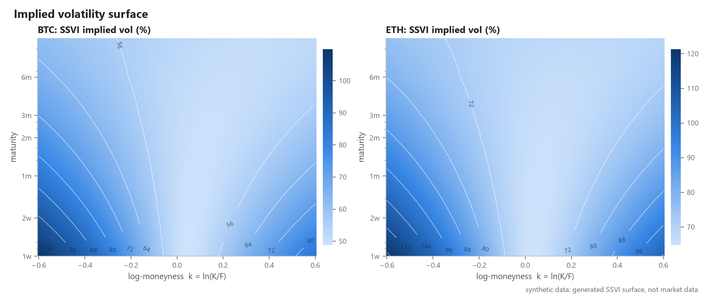
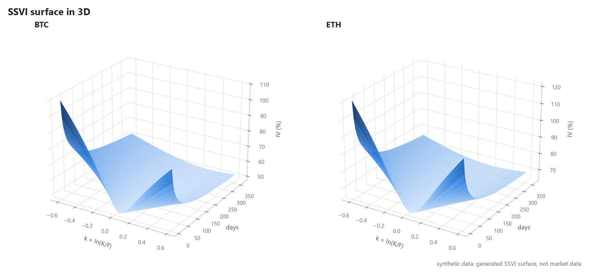
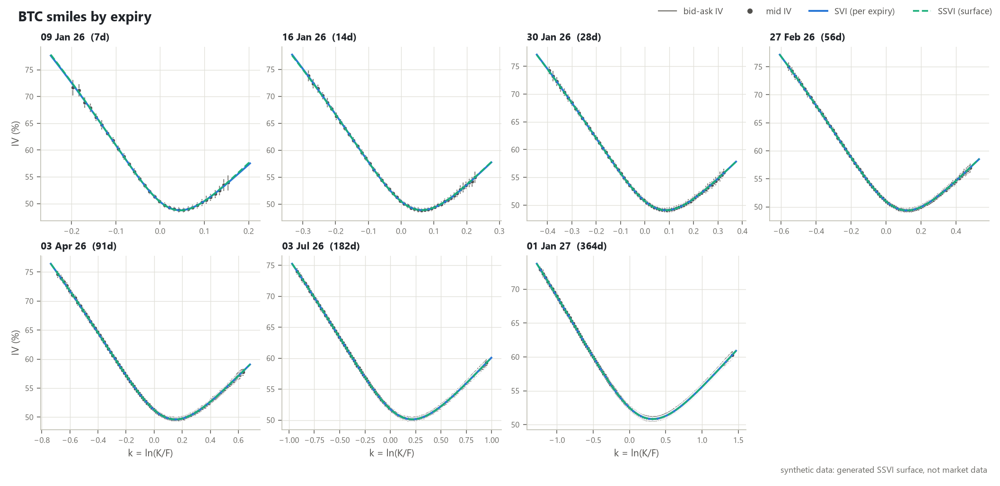
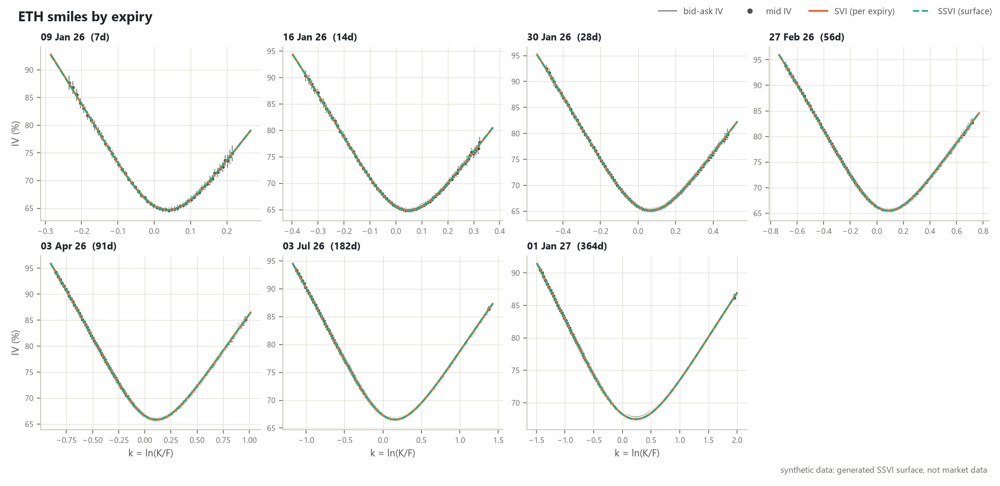
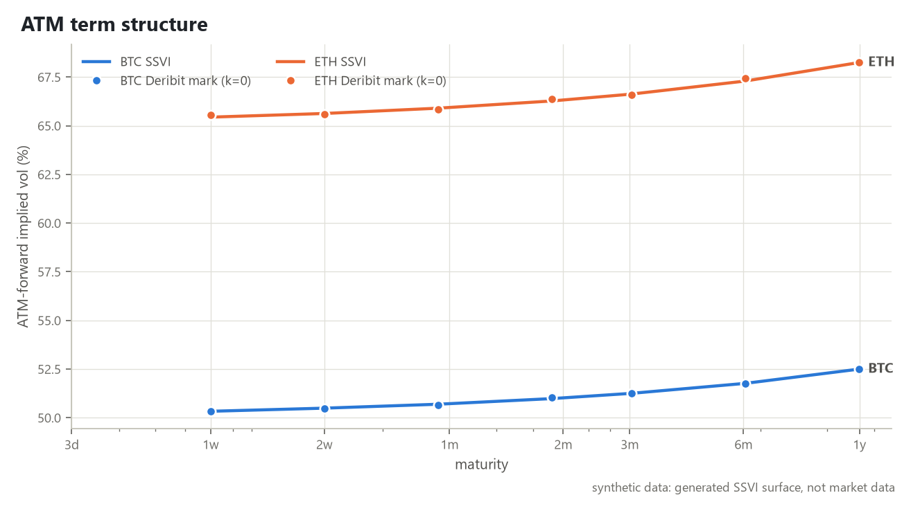
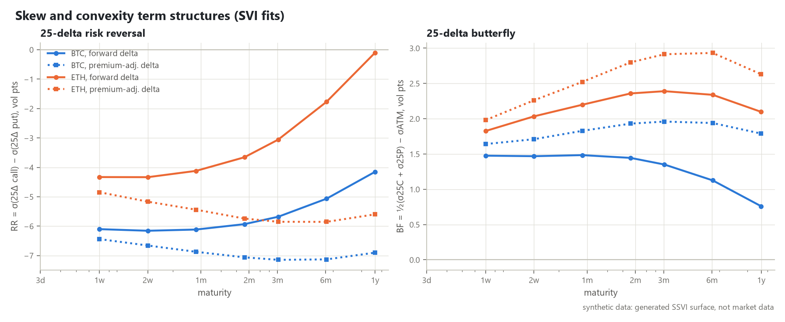
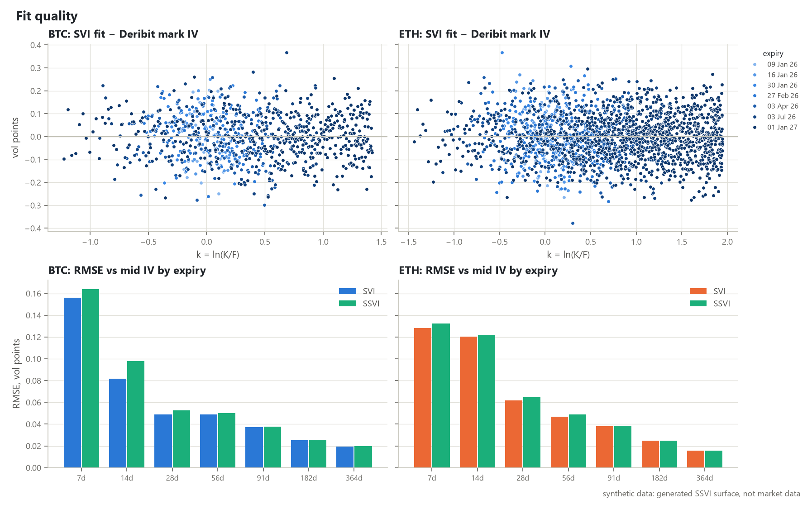
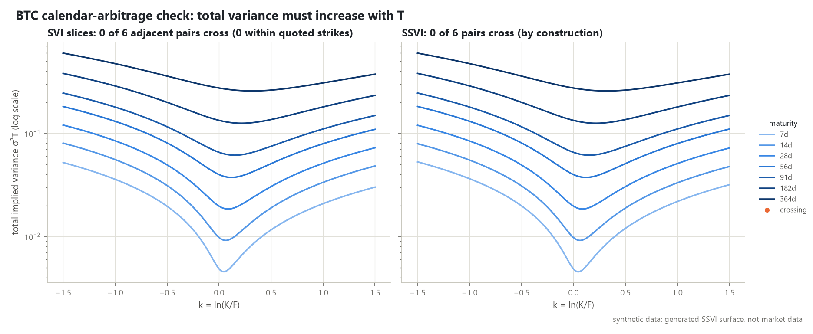
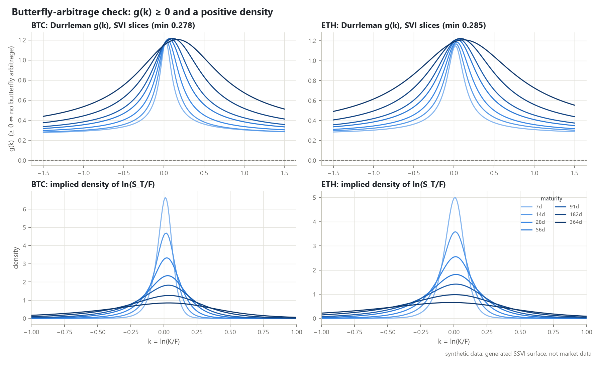

# crypto-vol-surface

[](https://github.com/YoussefElb75/crypto-vol-surface/actions/workflows/ci.yml)
[](LICENSE)

Build, fit and analyse **arbitrage-free implied volatility surfaces** for BTC and ETH options, from
Deribit's public API.

The pipeline: Deribit public API → dated snapshot → forwards and clean OTM smiles → **raw SVI**
per expiry with butterfly checks → **SSVI** surface with no-calendar and no-butterfly
constraints → ATM term structure, 25-delta risk reversal and butterfly, fit errors against
Deribit mark IV → **Black-76** prices and Greeks off the surface, repriced against the bid-ask.

> [!IMPORTANT]
> **Every figure and number published here comes from a synthetic surface, not from market data.**
> Deribit's terms restrict market data *and data derived from it* to personal use, and forbid
> publishing or redistributing it without Deribit's approval (see [DATA.md](DATA.md)). So this
> repository contains no Deribit snapshot and no result computed from one. The synthetic snapshot
> has Deribit's schema, tick size and quoting conventions, and is generated from a known SSVI
> surface, so the figures also show whether the pipeline recovers the truth. To run the same
> analysis on live data for your own personal use, see
> [Reproducing on live data](#reproducing-on-live-data).

Results on the synthetic snapshot (`tests/fixtures/synthetic/`): 7 expiries per currency from
1 week to 1 year, with 937 BTC-like and 2016 ETH-like quotes kept after cleaning. Quotes are
rounded to Deribit's 0.0001-coin tick, which is the only source of fit error.

| | BTC-like | ETH-like |
|---|---|---|
| SSVI parameters $`(\rho, \eta, \gamma)`$: true → fitted | (−0.25, 1.00, 0.45) → (−0.250, 1.001, 0.449) | (−0.15, 1.20, 0.40) → (−0.150, 1.200, 0.400) |
| SVI per expiry / SSVI surface: median RMSE vs mid IV | 0.05 / 0.05 vol pts | 0.05 / 0.05 vol pts |
| Repriced inside the bid-ask, SVI / SSVI | 100% / 100% | 100% / 100% |
| SVI slices free of butterfly arbitrage | 7 / 7 | 7 / 7 |
| Adjacent SVI slices that cross (calendar arbitrage) | 0 / 6 | 0 / 6 |
| SSVI static-arbitrage checks | pass | pass |

These numbers test the machinery, not the market. The synthetic truth is itself an SSVI surface,
so SSVI fits it as well as per-expiry SVI does. Real crypto smiles change skew across maturities,
which a single-$`\rho`$ SSVI cannot follow, and independent SVI slices can then cross in the
extrapolated wings. The figures and tables you build locally on live data show by how much.

## Figures

All figures below are built with `python scripts/make_figures.py --synthetic`, and each one says
"synthetic data" in its footer. Each has a light and a dark version, and GitHub shows the one that
matches your theme.

<picture>
  <source media="(prefers-color-scheme: dark)" srcset="docs/figures/surface_heatmap_dark.png">
  
</picture>

**Surface.** The fitted SSVI surfaces: a put-side skew in both, with the ETH-like surface set about
15 vol points above the BTC-like one at the money.

<picture>
  <source media="(prefers-color-scheme: dark)" srcset="docs/figures/surface_3d_dark.png">
  
</picture>

**3D view.** SSVI's curvature $`\varphi(\theta)`$ falls as total variance grows, so the smile is
steepest at the shortest expiry and flattens with maturity.

<picture>
  <source media="(prefers-color-scheme: dark)" srcset="docs/figures/smiles_btc_dark.png">
  
</picture>

**BTC-like smiles.** Per-expiry SVI and the SSVI surface overlap and stay inside every bid-ask bar,
which is the expected result when the truth is SSVI and the only noise is tick rounding.

<picture>
  <source media="(prefers-color-scheme: dark)" srcset="docs/figures/smiles_eth_dark.png">
  
</picture>

**ETH-like smiles.** The same check with a milder skew ($`\rho = -0.15`$) and more strikes per
expiry.

<picture>
  <source media="(prefers-color-scheme: dark)" srcset="docs/figures/atm_term_structure_dark.png">
  
</picture>

**ATM term structure.** The synthetic term structures rise gently, from 50% to 52% (BTC-like) and
from 65% to 68% (ETH-like). SVI, SSVI and the synthetic mark agree to about 0.1 vol points.

<picture>
  <source media="(prefers-color-scheme: dark)" srcset="docs/figures/rr_bf_term_structure_dark.png">
  
</picture>

**Risk reversal and butterfly.** Both 25-delta conventions on the same surface. Premium-adjusted
delta moves both strikes lower, so with a put skew the RR is more negative, and the gap widens with
maturity as $`V/F`$ grows.

<picture>
  <source media="(prefers-color-scheme: dark)" srcset="docs/figures/fit_errors_dark.png">
  
</picture>

**Fit errors.** The top row is the SVI fit minus the mark IV. In the synthetic snapshot the mark is
the true IV plus 0.1 vol point of noise, so this scatter is that noise. The bottom row compares SVI
and SSVI RMSE per expiry: it is largest at short expiries, where tick rounding matters most.

<picture>
  <source media="(prefers-color-scheme: dark)" srcset="docs/figures/arbitrage_total_variance_btc_dark.png">
  
</picture>

**Calendar check.** Total variance must increase with maturity at every $`k`$. Any crossing of
independent SVI slices is marked in orange, and the title counts the crossings within the quoted
strikes. There are none here; SSVI cannot cross, by construction.

<picture>
  <source media="(prefers-color-scheme: dark)" srcset="docs/figures/arbitrage_density_dark.png">
  
</picture>

**Butterfly check.** Durrleman's $`g(k)`$ stays positive for every SVI slice, so every implied
risk-neutral density is positive.

ETH's calendar figure is `docs/figures/arbitrage_total_variance_eth_*.png`.

## Reproducing on live data

For your own personal use, under Deribit's terms (see [DATA.md](DATA.md)):

```bash
python scripts/refresh_snapshots.py    # 10 public API requests -> data/snapshots/<stamp>/
python scripts/make_figures.py         # latest snapshot -> data/local/figures/, data/derived/live/
```

```python
rep = analyse(load_snapshot(latest_snapshot_dir("data/snapshots")), "BTC")
```

`data/snapshots/`, `data/local/` and `data/derived/` are git-ignored, so neither a snapshot nor
anything computed from one is committed. The demo notebook uses the latest live snapshot when
there is one: clear its outputs before committing, or set `CRYPTOVOL_SYNTHETIC=1` to force the
synthetic fixture. Do not publish what you build from live data without Deribit's approval.

## Mathematics

### Black-76 and Deribit's coin quotes

With forward $`F`$, strike $`K`$, maturity $`T`$ and volatility $`\sigma`$:

```math
C = F\,N(d_1) - K\,N(d_2), \qquad P = K\,N(-d_2) - F\,N(-d_1), \qquad
d_{1,2} = \frac{\ln(F/K) \pm \tfrac12\sigma^2 T}{\sigma\sqrt{T}} .
```

Deribit quotes options in coin. Its mark price is the Black-76 USD price at zero rate divided by the
forward, $`V_{coin} = V_{USD}/F`$; this was checked on live data. Implied vols are inverted from
$`V_{coin}\,F`$ by vectorised bisection plus a Newton polish.

### Forwards and moneyness

The forward is the futures mid for the same expiry. Without a future it falls back to put-call
parity on coin prices:

```math
(C - P)_{coin} = 1 - \frac{K}{F} \quad\Longrightarrow\quad F = \frac{K}{1 - (C-P)_{coin}},
```

taking the median over the strikes nearest the money. Log-moneyness is $`k = \ln(K/F)`$, total
variance is $`w(k,T) = \sigma^2(k,T)\,T`$, and only out-of-the-money options are used.

### Raw SVI and butterfly arbitrage

```math
w(k) = a + b\left\{\rho\,(k-m) + \sqrt{(k-m)^2 + \sigma^2}\right\}.
```

A slice has no butterfly arbitrage when the implied density is non-negative. That holds when
Durrleman's function is non-negative (Gatheral & Jacquier, 2014):

```math
g(k) = \left(1 - \frac{k\,w'}{2w}\right)^2 - \frac{w'^2}{4}\left(\frac{1}{w} + \frac14\right) + \frac{w''}{2} \;\ge\; 0,
\qquad
p(k) = \frac{g(k)}{\sqrt{2\pi w}}\exp\!\left(-\frac{d_2(k)^2}{2}\right).
```

The wings must also satisfy Lee's moment bound, $`b(1+|\rho|) \le 2`$. The fit minimises
weighted IV errors, with weights equal to the inverse bid-ask IV spread floored at 0.5 vol points.
Penalty residuals enforce $`g \ge 0`$ on a wide $`k`$ grid, $`\min w \ge 0`$ and the Lee bound.
Every fitted slice is then checked explicitly.

### SSVI and calendar arbitrage

```math
w(k, \theta_t) = \frac{\theta_t}{2}\left\{1 + \rho\,\varphi(\theta_t)\,k + \sqrt{\big(\varphi(\theta_t)\,k + \rho\big)^2 + 1 - \rho^2}\right\},
\qquad
\varphi(\theta) = \frac{\eta}{\theta^{\gamma}(1+\theta)^{1-\gamma}} .
```

Here $`\theta_t`$ is the ATM total variance. Following Gatheral & Jacquier (2014):

* **No calendar arbitrage (their Theorem 4.1):** $`\partial_t \theta_t \ge 0`$, enforced by
  fitting non-negative increments of $`\theta`$, together with
  $`0 \le \partial_\theta(\theta\varphi) \le \tfrac{1}{\rho^2}\big(1+\sqrt{1-\rho^2}\big)\varphi`$.
  For this $`\varphi`$, $`\partial_\theta(\theta\varphi) = \varphi\,(1-\gamma)/(1+\theta) \in [0, \varphi)`$,
  and the right-hand side is at least $`\varphi`$, so both inequalities hold for every $`\theta`$.
* **No butterfly arbitrage:** the sufficient conditions are $`\theta\varphi(1+|\rho|) < 4`$ and
  $`\theta\varphi^2(1+|\rho|) \le 4`$. Both hold for every $`\theta`$ when
  $`\eta(1+|\rho|) \le 2`$ and $`0 < \gamma \le \tfrac12`$. This is enforced by setting
  $`\eta = u \cdot 2/(1+|\rho|)`$ with $`u \in [0, 1]`$.

Between expiries $`\theta`$ is linear in $`T`$, so the interpolated surface stays
arbitrage-free. Every fit is also checked numerically: $`g \ge 0`$ on a grid and
$`w(k, T_{i+1}) \ge w(k, T_i)`$.

### 25-delta risk reversal and butterfly: which delta?

```math
\mathrm{RR}_{25} = \sigma_{25\Delta C} - \sigma_{25\Delta P}, \qquad
\mathrm{BF}_{25} = \tfrac12\left(\sigma_{25\Delta C} + \sigma_{25\Delta P}\right) - \sigma_{ATM},
```

with ATM meaning the ATM forward ($`k = 0`$). Deribit options are **inverse**: the premium is paid
in coin. Two deltas therefore make sense, and both are reported.

* **Forward delta (default):** $`\Delta = N(d_1)`$ for calls and $`N(d_1) - 1`$ for puts. It is
  what Deribit's own API returns (verified, see [DATA.md](DATA.md)), and the usual convention in
  crypto vol reporting and for non-premium-adjusted FX. At fixed vol it is monotone in strike.
  With a smile this is not guaranteed, so the solver scans a $`k`$ grid and requires a single
  crossing; it returns NaN if there are several.
* **Premium-adjusted delta:** $`\Delta^{pa} = \Delta - V/F`$, which is
  $`\tfrac{K}{F}N(d_2)`$ for calls and $`-\tfrac{K}{F}N(-d_2)`$ for puts. This is the coin
  hedge ratio of an inverse option, as for FX pairs whose premium is paid in the foreign
  currency. The call version is not monotone in $`K`$: it rises, peaks and falls, so the target
  is usually crossed twice. The 25-delta call is taken on the out-of-the-money branch, the
  largest-$`k`$ crossing.

Premium adjustment moves both 25-delta strikes lower. The call moves closer to the money and the put
further out. With a put skew this makes the RR more negative and the BF slightly larger, by more at
longer maturities.

### Greeks

Sticky-strike Black-76 Greeks come from the fitted surface: forward delta, premium-adjusted delta,
gamma, vega per vol point and theta per day. Each quote is repriced in coin with its own expiry's
forward and compared with the market bid and ask.

## Package layout

```
src/cryptovol/
  deribit.py     read-only client for Deribit public/* methods
  snapshots.py   Snapshot dataclass; fetch / save / load Parquet snapshots
  black76.py     prices, Greeks, premium-adjusted delta, implied vol (vectorised)
  cleaning.py    T, forwards (futures / parity), k, OTM selection, IVs, quote filters
  svi.py         raw SVI, Durrleman g(k), density, constrained fit
  ssvi.py        SSVI with calendar / butterfly constraints and checks
  surface.py     VolSurface (SVI slices or SSVI): iv, price, greeks; fit_surfaces
  analytics.py   ATM term structure, 25Δ RR/BF (both deltas), errors vs mark, repricing
  report.py      end-to-end pipeline per currency, derived CSV export
  synthetic.py   synthetic snapshot with a known SSVI ground truth (test fixture)
  plotting.py    light / dark themes for the figures
scripts/
  refresh_snapshots.py      the only script that calls the network
  make_figures.py           figures + derived tables from a snapshot
  make_synthetic_fixture.py regenerate tests/fixtures/synthetic/
notebooks/demo.ipynb        walk-through of the full pipeline (saved outputs: synthetic data)
tests/                      pytest suite on the synthetic snapshot (no network)
```

## Quickstart

```bash
python -m venv .venv
# Windows: .venv\Scripts\activate   |   macOS/Linux: source .venv/bin/activate
pip install -e ".[dev]"

pytest                                   # synthetic fixture only, no network
python scripts/make_figures.py --synthetic   # rebuild the published figures (docs/figures/)
```

```python
from cryptovol.snapshots import load_snapshot, latest_snapshot_dir
from cryptovol.report import analyse

rep = analyse(load_snapshot(latest_snapshot_dir("tests/fixtures/synthetic")), "BTC")
rep.comparison  # SVI vs SSVI quality per expiry
rep.rr_bf.query("model == 'ssvi'")  # 25Δ RR / BF, both delta conventions
rep.fits.ssvi.price(80_000, 0.25, False, unit="coin")  # 3-month 80k put, in BTC
```

CI runs `pytest` on Python 3.10, 3.12, 3.13 and 3.14. It also runs `pytest` on Python 3.10 with
the minimum declared versions of numpy, scipy, pandas, pyarrow and matplotlib. `ruff check .`,
`ruff format --check .` and `mypy` (strict, on `src/`) run on 3.13, and the demo notebook is
executed on the synthetic fixture.

## Tests

The suite reads only `tests/fixtures/synthetic/`. Its quotes come from a known SSVI surface,
rounded to Deribit's 0.0001-coin tick, so the tests can check against the truth:

* Black-76: a known value, put-call parity, IV round-trips over 400 random cases, Greeks against
  finite differences, and the premium-adjusted delta identity.
* SVI: $`g \equiv 1`$ for a flat smile, analytic against numerical derivatives, and Axel Vogt's
  arbitrageable slice flagged. Fitting that slice returns an arbitrage-free one. Also checked: the
  Lee bound, and that the density is positive and integrates to 1.
* SSVI: butterfly and calendar violations are detected, the sufficient conditions hold for all
  $`\theta`$, and the interpolated surface is checked on a dense $`(k, T)`$ grid. The fit recovers
  the true $`\rho, \eta, \gamma, \theta`$.
* Cleaning: futures and parity forwards (including the parity fallback), OTM selection,
  moneyness, and each quote filter triggered on purpose: short expiry, missing bid or ask,
  crossed book, no IV, wide spread, stale, far wing and thin expiry.
* Surface and pricing: repricing inside the bid-ask, and call prices decreasing and convex in
  strike, at and between expiries, for both surfaces. Each 25-delta strike hits its target delta
  under both conventions on both surfaces, with NaN when a target is unreachable. Also checked:
  SVI interpolation between nodes, ATM levels recovered, and the end-to-end report, whose
  derived CSVs must contain no per-quote columns.
* Snapshots and client: Parquet round-trip, schema, and the client tested with a fake HTTP
  session: it refuses non-public methods, and JSON-RPC errors and non-JSON HTTP errors raise.

## Limits of V1

* **Published results are synthetic.** They show that the pipeline recovers a known surface, not
  how it behaves on real quotes; run it on live data locally for that.
* **One snapshot, not a time series.** Each run describes a single moment.
* **Quote quality.** The book summary gives the best bid and ask without quote timestamps, so
  "stale" is approximated as zero open interest and zero volume. There is no depth and no
  size filter.
* **Forward curve outside the listed expiries** is extrapolated at the nearest carry rate and is
  not anchored to spot as $`T \to 0`$.
* **Zero rates.** $`df = 1`$, matching Deribit's mark model. USD discounting and the
  coin-funding rate are ignored. The futures basis is carried only in the forwards.
* **Expiries under 2 days are excluded.** The 1-day expiries carry event and microstructure
  effects that SVI is not designed for.
* **SSVI uses one $`\rho`$.** Crypto skew changes sign and size across maturities, so on live data
  SSVI fits worse than per-expiry SVI, mostly at short expiries. A natural V2 is eSSVI, with a $`\rho`$ per
  expiry under the Hendriks–Martini calendar conditions. Another is arbitrage-free SVI slices
  stitched under calendar constraints.
* **SVI calendar arbitrage is only checked.** The per-expiry SVI surface interpolates total
  variance linearly between slices, and its slices can cross, typically in the extrapolated
  wings; the calendar figure marks every crossing. Use the SSVI surface wherever calendar
  consistency matters, for example in far-wing pricing between expiries.
* **Arbitrage checks are numerical** on a finite $`k`$ grid of $`[-1.5, 1.5]`$ or wider, plus the
  analytic wing and SSVI bounds.
* **Greeks are sticky-strike Black-76 Greeks.** There is no smile dynamics and no
  vanna/volga adjustment.
* **Repricing uses each expiry's own cleaned forward**, so it tests the smile fit rather than the
  forward interpolation.

## References

* J. Gatheral, *A parsimonious arbitrage-free implied volatility parameterization with application
  to the valuation of volatility derivatives*, Global Derivatives, 2004.
* J. Gatheral and A. Jacquier, *Arbitrage-free SVI volatility surfaces*, Quantitative Finance 14(1), 2014.
* R. Lee, *The moment formula for implied volatility at extreme strikes*, Mathematical Finance 14(3), 2004.
* F. Black, *The pricing of commodity contracts*, Journal of Financial Economics 3, 1976 (Black-76).
* S. Hendriks and C. Martini, *The extended SSVI volatility surface*, Journal of Computational Finance, 2019.
* Deribit API v2 documentation: <https://docs.deribit.com/>

## Licence

[MIT](LICENSE) © 2026 YoussefElb75
